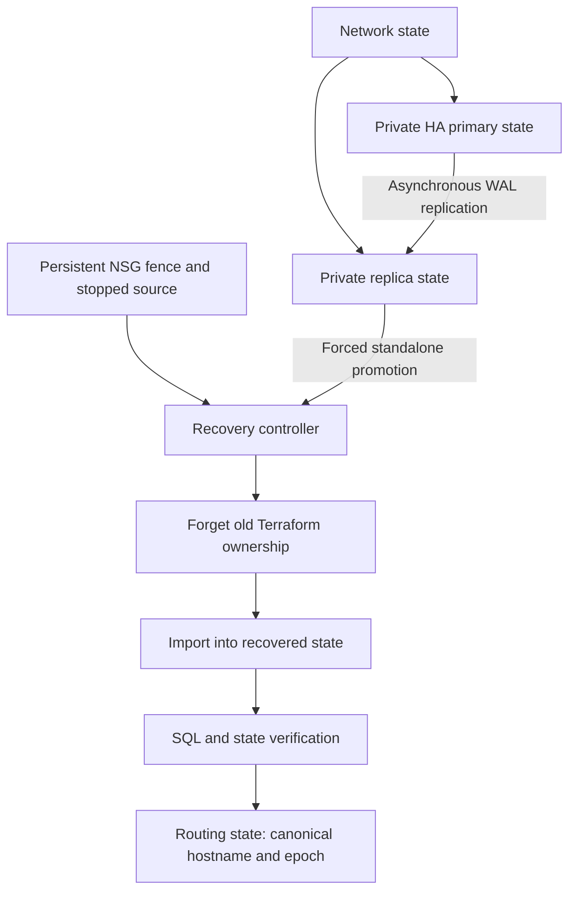

# Terraform Regional Recovery Control Plane

A Terraform-first PostgreSQL disaster-recovery system that treats state ownership, writer
fencing and recovery evidence as part of the architecture. It provisions a private,
zone-redundant primary in East US and an asynchronous read replica in West US 3. Recovery
requires an attached deny rule, an observed stopped source, explicit potential-data-loss
acknowledgement, standalone promotion, an actual SQL write probe, a non-destructive state
handoff, and a monotonic client-discovery change.

This is a deliberately demanding project. It addresses the dangerous gap between **a server
being promoted** and **Terraform safely managing that server afterward**. It includes reusable
Terraform modules, multiple independent remote states, mock-provider tests, an offline recovery
lab, a Python plan gate, a distributed recovery lease, Entra-only database access, manual OIDC
workflows and detailed failure/rebuild procedures. It does not present a database replica or a
DNS change by itself as a complete disaster-recovery solution.

## Architecture



The primary and recovery VNets are peered, with dedicated PostgreSQL-delegated subnets and
reserved client subnets. PostgreSQL private DNS and the writer discovery zone are linked to
both VNets and owned in the recovery resource group. Database public access and password
authentication are disabled. An existing Entra group is configured as database administrator.
A client must already have network access to these private VNets through an approved runner,
VPN or connectivity design; this repository does not provision a VM or a VPN as a shortcut.

## Why the Terraform work is difficult

1. **Independent failure domains:** normal operation has network, primary, replica and routing
   states. Recovery does not refresh the failed primary database state to manage the healthy
   secondary database. Cross-state inputs are explicit nonsensitive contracts, not broad access
   to somebody else's remote state snapshot.
2. **Non-destructive state migration:** replica-detach deliberately shares the original replica
   backend key and uses a removed block with destroy=false. recovered imports the promoted
   server and its Entra administrator into a new state. There must never be two active owners.
3. **A plan can be valid and still dangerous:** the JSON gate rejects replacements, deletes,
   incomplete/deferred plans, unapproved resource classes, cloud changes during import, premature
   routing, stale evidence, automatic failback and reverse epochs. Original database roots are
   frozen once an incident journal exists.
4. **Provider state is not replication truth:** the pinned provider preserves some creation and
   replication fields from its state. A normal refresh is not proof that a server still replicates.
   Recovery checks the Azure server role/source independently through Azure CLI.
5. **Writer safety spans layers:** denying new connections alone does not terminate established
   sessions. The controller requires both the persistent subnet NSG deny and the source stopped.
   Stopping a server alone is not permanent fencing because Azure can restart stopped servers.
6. **Saved-plan execution and serialization:** approved workflows apply the exact gated plan.
   A control-blob lease spans live checks, Terraform planning and apply, with separate Terraform
   backend leases protecting each state. A crashed controller leaves a lock for explicit recovery.

## Repository structure

| Path | Purpose |
| --- | --- |
| modules/database | Private Entra-only PostgreSQL module with lifecycle protection |
| stacks/network | Peering, delegated subnets, attached NSGs, persistent fence and private DNS |
| stacks/primary | Zone-redundant primary and geo-redundant backups |
| stacks/replica | Initial cross-region read replica |
| stacks/replica-detach | Forget replica module ownership without deleting Azure resources |
| stacks/recovered | Import-only adoption of the promoted standalone server |
| stacks/routing | Short-lived TXT writer contract using canonical TLS hostname and epoch |
| recovery/policy.py | Fail-closed plan, fence, adoption, topology and evidence policies |
| recovery/live.py | Explicit Azure observations, promotion, SQL probe and private journal |
| recovery/locked_stage.py | Distributed lock around live Terraform operations |
| recovery/discovery.py | Example client discovery parser with minimum-epoch checks |
| tests | Offline failure scenarios and recovery simulations |
| docs | Deployment, identity, recovery, rebuild and validation evidence |

## Prerequisites and local validation

Use Terraform **1.13.0**, AzureRM **4.68.0**, Python 3.12, Bash, Azure CLI, PostgreSQL psql with
trusted CA certificates, and dig for the sample client. The provider version is intentionally
pinned and locked for reproducibility; it is not claimed to be the newest release. Unit tests
use only Python's standard library. Terraform mock-provider tests do not authenticate to Azure.

```bash
git clone https://github.com/dotman01k/azure-terraform-regional-recovery.git
cd azure-terraform-regional-recovery
bash scripts/validate.sh
```

The validation command checks Python recovery behavior, Bash syntax, Terraform formatting,
provider schema validation on every root, and Terraform mock-provider plans. Provider download
and registry access are needed, but no Azure identity is required. The repository's hosted CI
runs these checks on each push and pull request. Local provider execution was restricted by the
preparation runtime's Unix-socket policy; see docs/validation.md for the precise evidence and
CI result rather than treating that local limitation as a passing provider check.

## Exact setup and deployment

**Do not deploy just to read or test this project.** The HA primary and always-running replica
are substantial billable infrastructure. Source, offline policy tests and hosted source CI are
separate from a live sandbox. Follow docs/deployment.md to bootstrap the two resource groups,
a pre-existing state/control account and the private operator runner.

Live workflows use an existing Linux self-hosted runner labelled dr-operator with private
connectivity to both regions. Never attach untrusted pull-request jobs to this runner. CI stays
on GitHub-hosted runners. Configure the dr-control GitHub environment, required reviewers,
main-only deployment branches and exact environment-scoped OIDC federation. The workflow name
alone is not an approval gate. No client secrets, database passwords or storage keys are used.

The live stage workflow accepts one reviewed stack and plan/apply operation. Each root's JSON
variables are stored in its corresponding environment variable: NETWORK_TFVARS_JSON,
PRIMARY_TFVARS_JSON, REPLICA_TFVARS_JSON, REPLICA_DETACH_TFVARS_JSON,
RECOVERED_TFVARS_JSON and ROUTING_TFVARS_JSON. Examples use synthetic GUIDs and names; replace
those with actual outputs and reviewed IDs. Set RECOVERY_MANIFEST_JSON to the reviewed manifest,
BACKEND_ACCOUNT and BACKEND_RESOURCE_GROUP to the existing backend, and the documented Azure
OIDC variables. Plan/log files remain private under .run on the operator runner; workflows do
not upload them to public artifacts.

Initial order is network → primary → replica → routing. The initial route points to the primary
canonical hostname with epoch 1. Review the plan before choosing apply. The two resource groups
are pre-created and only read by network state, allowing RG-scoped infrastructure permissions.
Provider registration is an administrator's prerequisite, not a permission granted to normal CI.

Terraform provisions infrastructure and controls state ownership. Azure CLI performs the explicit
one-way database promotion because the required forced standalone recovery behavior and its
observations are not equivalent to merely editing create_mode in configuration. SQL verifies
that the promoted endpoint actually permits a transaction. These are intentionally different
operations with separate evidence.

## Recovery sequence

The detailed runbook is docs/recovery.md. The short operational sequence is:

1. Open an incident, stop ordinary changes and inspect source/target state and replication lag.
2. Plan/apply network state with fence_primary=true. Confirm the deny rule is attached to the
   primary database subnet. New direct client connections to TCP 5432 are denied.
3. Run stop-primary. The controller verifies the deny rule before stopping the source and then
   checks its stopped state. This terminates existing source sessions. If Azure cannot prove
   fencing, recovery stops; an unavailable control plane is not accepted as evidence of fencing.
4. Authorize forced recovery, acknowledging possible asynchronous-replication data loss. This
   binds incident, target, manifest hash and routing epoch in a private blob journal.
5. Promote the replica to an independent writer. An uncertain response is reconciled by
   re-reading its actual role before any retry. No automatic switchover or zero-RPO claim is made.
6. Probe the writer over TLS using a short-lived Entra token. The probe executes a transaction
   containing a write and rolls it back. Management-plane Ready status is insufficient.
7. Plan/apply replica-detach against the OLD replica key. Verify that changes only forget
   ownership. Do not use terraform destroy, state rm or a force-push as a recovery shortcut.
8. Plan/apply recovered imports against a NEW recovered key. The plan must contain no cloud
   changes. Align configuration with observed server settings if necessary; never bypass the gate.
9. Run adopted to verify both backend identities, distinct state lineages, empty old ownership,
   exact target ownership and another SQL probe.
10. Set the route to the target canonical hostname and epoch 2. Its apply rechecks the fence,
    target, ownership and SQL probe while holding the distributed lease.

After promotion there is no automatic reverse replication. The old primary remains fenced.
Failback is a separate rebuild and replication design; see docs/rebuild.md. A recovered route
must never be casually changed back to the old source because an Azure status turns green.

## Client routing and TLS

The routing state publishes TXT JSON such as a canonical PostgreSQL hostname and epoch. It
does not publish a PostgreSQL CNAME alias as the connection host: arbitrary aliases can break
verify-full certificate validation. Clients adopting this discovery contract resolve the TXT,
validate the allowed hostname and minimum epoch, and connect with that canonical hostname.
Existing applications do not adopt this behavior automatically.

```bash
python -m recovery.discovery --manifest .run/manifest.json --minimum-epoch 2
```

The client/VNet needs the configured private DNS zone. Applications must persist a minimum
accepted epoch, refresh expired discovery information, handle connection pool turnover and
reject unsupported epochs. DNS TTL is not a fencing mechanism. NSG fencing and stopping the
old source protect stale supported clients; out-of-band access paths or operator-level Azure
changes are outside these application guarantees.

## Identity and RBAC

Infrastructure deployment requires Contributor over the two project RGs and authority to
create the declared network/DB/DNS resources. Entra group registration and membership are
bootstrap administrator operations. Backend and recovery actors need Storage Blob Data
Contributor on their respective state/control containers. Reading full Terraform state is a
privileged operation even without database passwords. Routing-only operators can be scoped
to the routing zone when using a separate identity after the initial lab.

The recovery identity needs read/stop/write rights on the source/target servers, read rights
on the attached NSG/subnet and access to the private journal/control blob. Its SQL token identity
must be a validated member of the configured Entra admin group for the lab probe. Test that
identity path in a healthy environment; successful ARM login is not SQL authorization. An
enterprise variant should separate creation, recovery and SQL-probe privileges further.

## Operations, troubleshooting and costs

| Failure | Required response |
| --- | --- |
| Source or fence cannot be verified | Stop; restore observability or use an organization-approved external fencing design outside this controller. |
| Replica is unhealthy or has unexpected source/auth | Stop and investigate; never route solely because a server exists. |
| Forced promotion times out | Resume promotion; the controller checks for an independent writer before sending another promote request. |
| Import wants a replacement/update | Compare immutable network, source, creation-only fields and observed settings. Adoption must remain no-op/import only. |
| Original replica state still owns the target | Do not import elsewhere; complete the reviewed forget-only stage first. |
| Lease remains after runner failure | Inspect all active runs/controllers, then follow explicit lock recovery. Never automatically break a live lease. |
| Stale evidence or discovery epoch | Re-probe, refresh adoption evidence and reject cached routes. |
| Primary returns after incident | Keep its NSG fence. Rebuild topology deliberately; do not auto-failback. |

A General Purpose HA primary runs primary and standby capacity, and the replica adds another
server. Storage, backups, cross-region network transfer, private DNS and state storage also
have costs. Stopping the source reduces only some compute charges and Azure can restart stopped
servers after the service's stop window. This is not a low-cost always-on lab. RPO and RTO are
measured results of a real drill, not configurable promises made by Terraform. No monetary
estimate is guessed; review Azure pricing for your region/offer before apply.

## Cleanup and limitations

The normal gate rejects deletion and database resources have prevent_destroy. Retirement is
an explicitly reviewed maintenance change: export needed data/evidence, stop clients, identify
the SINGLE current owner of every database, retire routes, remove replicas before primaries,
and remove lifecycle protection only in a reviewed teardown branch. Delete only dedicated
project resources and then their manually created RGs. Preserve state and journal versions
until the inventory is reconciled; remove Entra federation and operator access separately.
A generic terraform destroy command would conflict with the protections this project is testing.

The controller intentionally refuses unfenced promotion during a total source-region control
plane outage. It does not claim universal automated disaster failover, exactly-once application
writes, guaranteed lag bounds, automated failback, regional availability or tenant-admin safety.
State/control storage in the recovery region is a dependency of recovery. The private runner,
DNS connectivity, Entra identity, certificate trust and provider capability need separate live
acceptance tests. Provider mock tests prove configuration contracts, not service support or
successful recovery. See docs/validation.md for actual checks and remaining drill evidence.

## Official references

Checked 2026-10-22:

- https://developer.hashicorp.com/terraform/language/tests/mocking
- https://developer.hashicorp.com/terraform/language/block/removed
- https://developer.hashicorp.com/terraform/language/import
- https://registry.terraform.io/providers/hashicorp/azurerm/4.68.0/docs/resources/postgresql_flexible_server
- https://github.com/hashicorp/terraform-provider-azurerm/blob/v4.68.0/internal/services/postgres/postgresql_flexible_server_resource.go
- https://learn.microsoft.com/azure/postgresql/read-replica/concepts-read-replicas-promote
- https://learn.microsoft.com/cli/azure/postgres/flexible-server/replica
- https://learn.microsoft.com/azure/postgresql/network/concepts-networking-private
- https://docs.github.com/actions/reference/security/oidc
